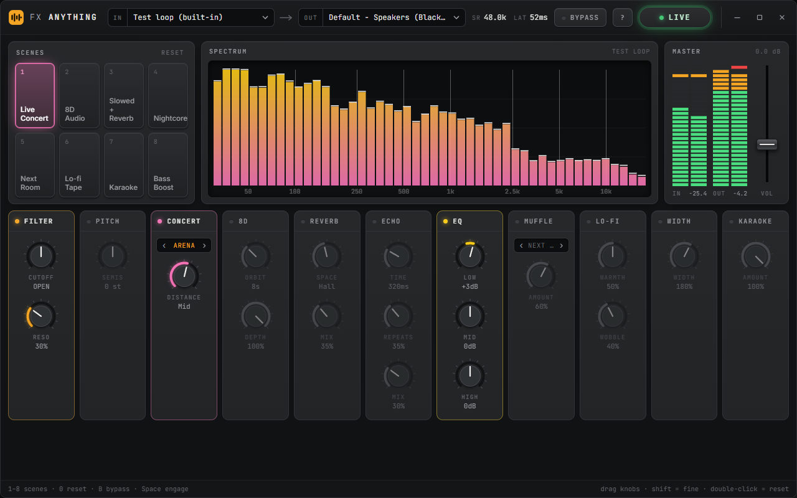

<h1 align="center">FX Anything</h1>

<b>Live effects on anything your PC plays.</b> 
Concert venues, 8D audio, slowed + reverb, nightcore, a DJ filter and more. All in real time.

  <a href="../../releases/latest"><b>⬇ Download for Windows</b></a> ·
  <a href="https://monnapse.github.io/fx-anything/"><b>▶ Hear it in your browser</b></a>

## What it does

FX Anything is a small desktop effects rack (a 1.6 MB download). Route any app's sound into it, whether that's Spotify, YouTube in a browser or a game, and twist knobs to reshape it live.

| Module | What it does |
| --- | --- |
| **DJ Filter** | One knob: sweep left for low-pass, right for high-pass, with resonance |
| **Pitch** | ±12 semitones without changing speed (the slowed / nightcore sound) |
| **Concert** | Club, theater, arena, stadium or festival, with distance from the stage |
| **8D** | The sound orbits your head (headphones) |
| **Reverb / Echo** | Room to infinite space, plus a repeating delay |
| **EQ / Width** | Bass, mids, treble and a stereo widener |
| **Muffle** | Next room, underwater, radio, phone |
| **Lo-fi** | Warm, wobbly tape |
| **Karaoke** | Removes centred vocals |

Eight **scene pads** (keys 1–8) load one-tap remixes. **B** bypasses everything so you can compare. A limiter on the output keeps it from clipping.

## Install

1. Download `FX.Anything_x.y.z_x64-setup.exe` from [Releases](../../releases/latest) and run it.
   The installer isn't code-signed yet, so Windows SmartScreen may warn. Click **More info → Run anyway**.
2. Install the free [VB-CABLE](https://vb-audio.com/Cable/) virtual audio driver.
3. Open **Settings → System → Sound → Volume mixer** and set the app you want to remix (e.g. Spotify) to output to **CABLE Input**.
4. In FX Anything set **IN = CABLE Output** and **OUT = your headphones/speakers**, then press **ENGAGE**.

To go back to normal, set the app back to **Default** in the volume mixer.

> No VB-CABLE yet? Pick **Test loop (built-in)** as the input to try the effects.

## Troubleshooting

- **I hear the original and the effects at the same time.** Windows is also playing the cable directly. Open `mmsys.cpl` → **Recording** → **CABLE Output** → **Listen**, and untick **Listen to this device**.
- **I hear nothing.** Make sure the app plays to **CABLE Input**, FX Anything's IN is **CABLE Output**, and OUT is not set to CABLE Input.
- **An app isn't in the volume mixer list.** Start playing something in it first; some apps also need a restart after you change their output.

## Contributing

Bug reports and ideas are welcome in [Issues](../../issues). To build it yourself or work on the code, see [CONTRIBUTING.md](CONTRIBUTING.md).

## License

[MIT](LICENSE). The website's demo track is "Arpeggio Synthesized Funk" by [BaDoink](https://freesound.org/people/BaDoink/sounds/534619) (CC0).
